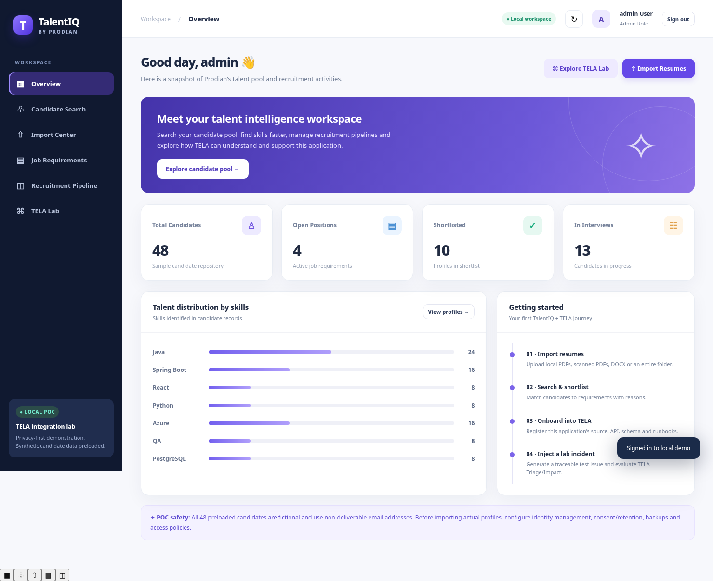
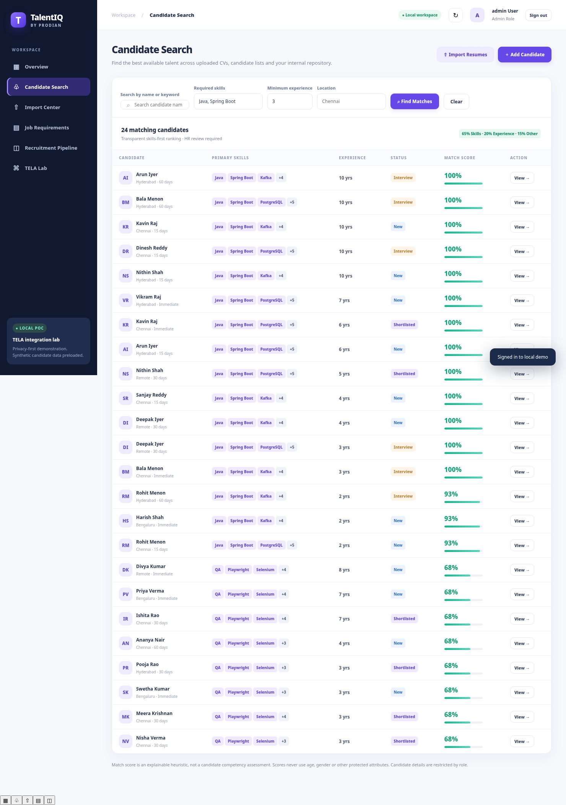

# Prodian TalentIQ — Executable POC (v0.1)

**Purpose:** A visually polished, local-first recruiting application that Prodian can evolve into a real HR system, and a controlled application under test for **TELA Knowledge, Assist, Insight, Triage, Impact and Agents**.

> ⚠️ **Not production-approved.** Uses a local SQLite DB and seeded shared-password demo identities. Only synthetic data should be used until Entra/Keycloak SSO, production audit controls, consent, retention, approved storage and security tests are completed. See `docs/SECURITY_PRIVACY.md`.

## Preview





## What is working in this package

- Responsive TalentIQ browser UI: dashboard, searchable ranked profiles, candidate detail, editable recruitment stage, JD requirements, pipeline, import center and TELA test lab.
- 48 **synthetic** fictional candidate records and 4 JD requirements seed automatically. Example addresses use `example.invalid`.
- Upload many files or select a **local folder from Chrome/Edge**. Import DOCX, searchable PDF, scanned PDF, images, TXT, CSV. Legacy `.doc` requires local LibreOffice conversion. Image/scanned PDFs use local Tesseract OCR.
- Extract likely name, email, phone, technical skills and experience; mark imported records for **human verification**.
- Detect identical file hashes / duplicate emails. Search and transparent score (65% skills, 20% experience, 10% location, 5% availability).
- Local demo login roles `admin`, `hr`, `lead`; contact information restricted from `lead`.
- Synthetic incident injection with trace IDs, documented dependency map and local audit events.
- Separate read-only API gateway for TELA tools using an explicit service secret; outputs opaque candidate references instead of contact PII.
- Four-eyes approval example for resolution of **synthetic incidents only**. Does not retry live workloads.
- Automatically generated OpenAPI contract at `/openapi.json`, interactive Swagger at `/docs`.
- Automated backend tests.

## Status and deliberate technology choice

For the **fastest working POC**, this executable first version uses **Python FastAPI + SQLite + plain JS/CSS** instead of the earlier proposed Spring Boot + React + PostgreSQL. The advantage is one local process, integrated OCR and no Node build step. The schema-driven preview in TELA Lab runs an approved **static** form definition, not a form authored by TELA itself. The modular API contract and data model are designed for a later Spring Boot / React / PostgreSQL production implementation. **No production stack migration has been done yet**. TELA is an independent platform and is **not automatically connected** by this package.

## Recommended setup: Windows 11 + WSL Ubuntu 24.04 + VS Code

Your TELA POC is already inside WSL. Use a **separate project folder and port** to avoid disturbing it.

1. Open **WSL Ubuntu** terminal and copy/extract this project to `~/projects/Prodian-TalentIQ`. (Avoid extracting it inside your TELA source checkout.)
2. In WSL, install prerequisites:

```bash
sudo apt update
sudo apt install -y python3 python3-venv python3-pip tesseract-ocr tesseract-ocr-eng
# Only if you need old binary .doc files:
sudo apt install -y libreoffice-writer
```

3. Start the application:

```bash
cd ~/projects/Prodian-TalentIQ
python3 -m venv .venv
source .venv/bin/activate
pip install -r requirements.txt
cp .env.example .env
# Edit .env to replace session/service secrets and demo password
set -a; source .env; set +a
uvicorn backend.app:app --host 127.0.0.1 --port 8091 --reload
```

4. Open **http://localhost:8091** in Windows Chrome or Edge. Sign in as `admin`, `hr` or `lead` using the `TALENTIQ_DEMO_PASSWORD` value from `.env` (initial example: `LocalDemo#2026`). Never expose this demo on a public port.
5. Open the project in **VS Code** from WSL:

```bash
code .
```

Install VS Code **Remote - WSL** extension if prompted. There is no need to stop TELA. Keep TELA on its existing ports and TalentIQ on **8091**.

### Windows PowerShell alternative

From an extracted project folder on Windows, install Python 3.11+ and Tesseract, then run:

```powershell
py -m venv .venv
.\.venv\Scripts\Activate.ps1
pip install -r requirements.txt
Copy-Item .env.example .env
# Edit .env, then load its keys into your shell or run scripts/run-windows.ps1
.\scripts\run-windows.ps1
```

If you run `scripts/run-windows.ps1`, it loads `.env`, creates the environment if required, installs packages, and starts the app on localhost:8091. OCR requires Tesseract accessible on your PATH.

## How local folder search actually works

1. Press **Import Center → Select Folder**.
2. Choose a folder such as `C:\Prodian\HR\Resumes` from your browser.
3. The browser presents supported files for upload; it cannot search your hard drive silently.
4. Each file is parsed/OCR'ed, stored as a resume under `data/resumes/`, and indexed as a candidate record in `data/talentiq.sqlite3`.
5. Select **Candidate Search**, enter desired skills, minimum experience and location, then inspect contact details with the HR role.

This is **one-time ingestion**, followed by search across the TalentIQ repository. Automatic folder watching and incremental synchronization are future features.

## How to run the TELA learning POC

1. Explore TalentIQ and upload **only bundled synthetic samples** initially.
2. In your existing TELA Admin/Knowledge UI, onboard this repository's Markdown architecture, schema, API contract, application source and runbooks as a **new application**. Verify the exact workflow of your installed TELA version; don't assume all proposed integrations are already implemented.
3. Ask TELA Assist what code owns candidate search, how a resume moves from OCR to the database, and which endpoints touch the candidate table.
4. In **TELA Lab**, inject a synthetic incident, copy its request/trace ID, give TELA the sanitized incident and dependency map and compare its investigation against the ground truth.
5. Optionally configure `TALENTIQ_TELA_KEY` and build an approved TELA MCP/API adapter around `/api/tela/tools/*`. The available routes do not themselves install an MCP connector into TELA.
6. Use the static form schema endpoint `/api/form-definitions/candidate-search` to test TELA's ability to **describe or propose** a new form. Runtime TELA-generated forms are a separate future capability.

Detailed steps and readiness matrix: `docs/TELA_INTEGRATION.md`, `docs/TELA_TEST_MATRIX.md`.

## Project layout

```
Prodian-TalentIQ/
  backend/app.py            FastAPI endpoints, demo roles, upload, incidents, TELA tools
  backend/parser.py         DOCX/PDF/scanned PDF/image text extraction and OCR
  backend/matcher.py        Skill normalization and explainable matching
  backend/db.py             SQLite schema and synthetic data seeding
  web/index.html            UI entry point
  web/styles.css            Responsive visual design system
  web/app.js                Interactive HR screens
  docs/                     Requirements, architecture, schema, API, TELA, security, runbook
  samples/resumes/          Synthetic sample TXT/DOCX/PDF/scanned PDF for OCR checks
  samples/candidates.csv    Synthetic CSV import
  scripts/                  Setup scripts and synthetic artifact generation
  tests/                    Automated verification
  docker-compose.yml        Alternative localhost-only Docker deployment
```

## Run tests

```bash
source .venv/bin/activate
python -m pytest -q tests
```

## Useful local API checks

```bash
curl http://127.0.0.1:8091/api/ops/health
# Swagger: http://127.0.0.1:8091/docs
```

## Limitations (not hidden)

- LinkedIn/Naukri **live search is not included**: requires licensed terms/partner APIs. Unauthorized scraping is excluded.
- Outlook ingestion, automatic background folder watching, CV semantic embeddings, JD file upload, multi-tenant isolation, production SSO, encrypted object storage, antivirus scanning, PostgreSQL and audit export are planned, not implemented.
- OCR depends on local Tesseract. Parsed name/experience are heuristic and always marked for review.
- TELA does not automatically ingest TalentIQ code or logs; you must onboard them in your current TELA instance and connect approved tool interfaces.
- The local lab injector produces **synthetic incident records** and log evidence, **not real HTTP 500s or real broken database schema**. You can later add isolated integration-test environments for actual fault injection.
- Approval demo only changes a synthetic incident from open to resolved; no agent executes arbitrary commands.
- Production-grade data quality, access/consent, matching evaluations and HR bias review are open work.

**Start here:** `docs/PRODUCT_REQUIREMENTS.md` → `docs/ARCHITECTURE.md` → `docs/TELA_INTEGRATION.md`.
