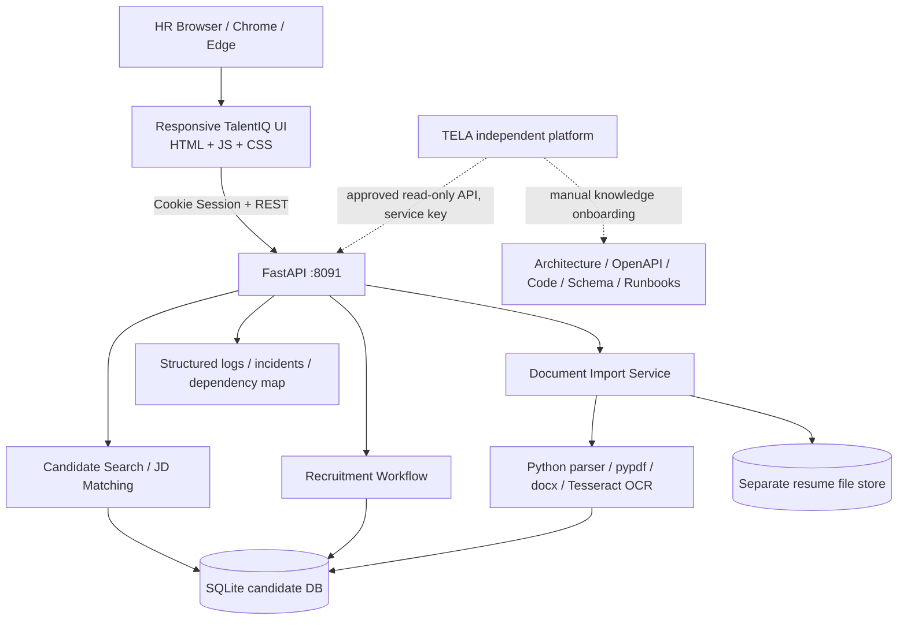
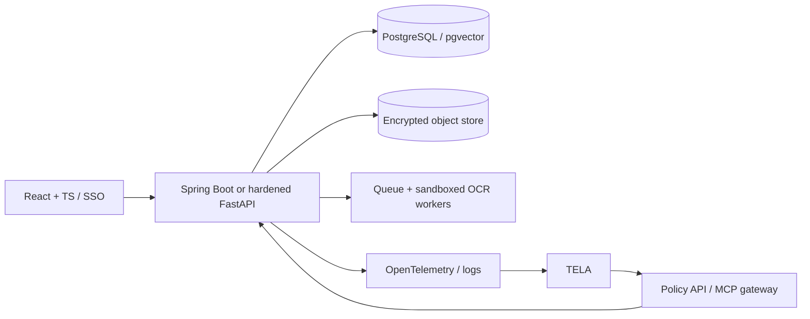

# TalentIQ — Technical and Integration Architecture

## Current executable POC

## Boundary ownership
- **TalentIQ** owns resumes, candidate records, HR workflow, ranking, matching and recruitment state.
- **TELA** owns enterprise knowledge, prompts/retrieval, grounded application interpretation, diagnostic workflows and agent orchestration once implemented/configured.
- TalentIQ has no direct dependency on TELA to run.
- They use separate database/storage, credentials and ports.

## Data processing
`User selects local files -> browser multipart upload -> type/size/hash checks -> parser (PDF/DOCX/OCR/CSV) -> candidate record + original file -> search/match UI`. Original resumes stay in local `data/resumes`. No external OCR/LLM calls are made by TalentIQ v0.1.

## Search and ranking
Candidate skills stored as normalized comma-separated technical terms in prototype. Search uses application code and SQLite rows. Production architecture should move to normalized skills tables + PostgreSQL indexes, and optionally pgvector for **local** semantic matching. Keep scoring explainable and separate from optional LLM recommendations.

## TELA flows
1. **Knowledge**: repo files / markdown / OpenAPI / schema are ingested via supported TELA UI/capability; chunks embedded and approved under configured TELA governance.
2. **Assist architecture**: TELA retrieves relevant knowledge to explain endpoint, modules, data flow with citations.
3. **Assist operational query**: authorized tool uses POST `/api/tela/tools/search-candidates`; only returns anonymized candidate refs and skill-match evidence. HR user opens the corresponding record in TalentIQ for contact details.
4. **Triage**: lab incident logs/trace plus approved knowledge become the diagnostic input. In v0.1 ingestion of this telemetry into TELA is **manual**, unless an actual connector has been configured.
5. **Impact**: GET `/api/ops/dependency-map` tells which code, APIs and tables a simulated failure affects. Graph automation is a future increment.
6. **Agents**: a prepare/approve/execute loop resolves a synthetic incident status after four-eyes approval. Real production remediation remains disabled.

## Target production architecture (not delivered yet)

## Privacy boundary
TalentIQ is the source of truth for PII; model-facing tools return candidate references instead of names, phones, emails and raw resume text. This differs from a direct HR UI search, where role-approved contact fields are displayed. Any future tool that releases contact details needs explicit per-user authorization, audit and deployment-specific LLM policy.
