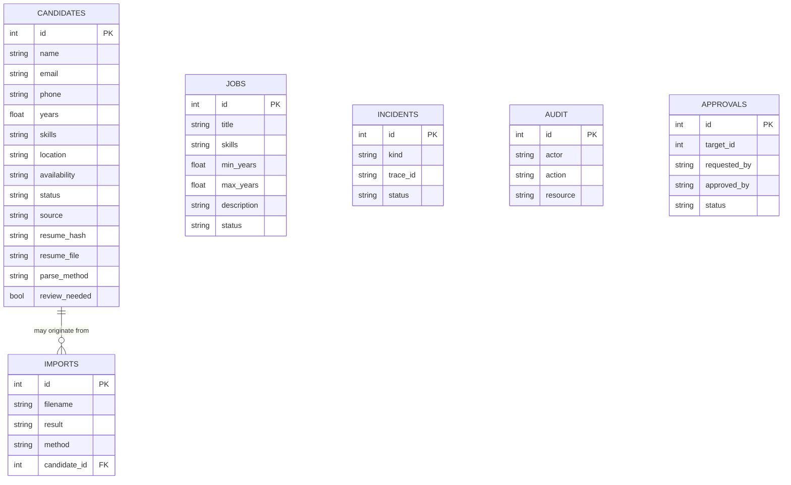

# TalentIQ — Database and Logical Entities

**Current storage:** local SQLite (`backend/db.py`) owned by TalentIQ, not by TELA. Production move to PostgreSQL remains planned.

## ER representation

## Important fields
- `candidates.email` — soft duplicate check; not a guaranteed unique key when email unavailable.
- `candidates.resume_hash` — SHA-256 for exact duplicate-file detection.
- `candidates.extracted_text` — prototype-only unstructured text (can contain PII); never send wholesale to LLM.
- `candidates.review_needed` — imported profiles require HR review.
- `candidates.status` — `New`, `Shortlisted`, `Interview`, `Selected`, `Rejected`, `On Hold`.
- `imports` — per-file provenance, OCR method, import failures.
- `incidents` — synthetic lab events, not proof that a real API outage happened.
- `approvals` — four-eyes state machine for a narrowly scoped lab operation.

## Production normalization backlog
CandidateSkill(candidate_id, skill_id, evidence, years), SkillAlias, ResumeVersion, Consent, DataRetentionPolicy, JobRequirement, JobCandidateMatch, InterviewFeedback, HiringDecision, SourceIntegration, AccessGrant, Tenant. Apply tenant row-level security/authorization. Remove raw PII from general purpose logs and AI indexes.
